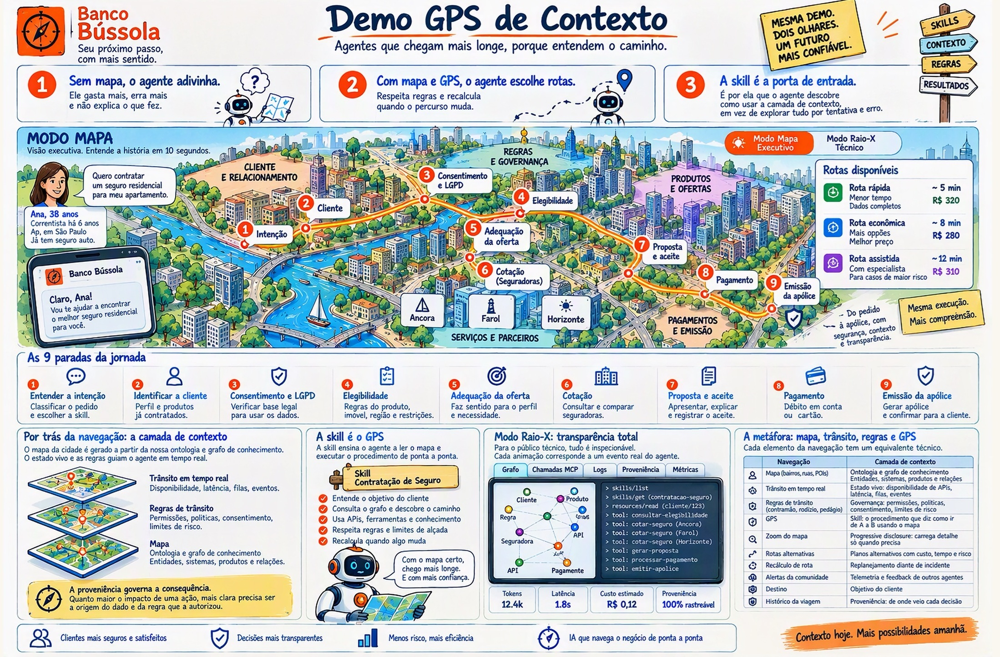

# Demo GPS de Contexto — Especificação

Versão de 01/11/2026 · Ricardo Coelho de Sousa · atualizada com as decisões das Fases 1 a 4

## Visão e mensagem central

Agentes de IA só são confiáveis quando navegam sobre uma camada de contexto: um mapa semântico do negócio, com estado vivo e regras de governança. As skills são o GPS que ensina o agente a ler esse mapa.

A demo mostra isso numa jornada de contratação de seguro, com uma visualização que lembra Google Maps e Waze. O público entende a ideia sem precisar de jargão e depois vê o que acontece por baixo.

Três mensagens precisam sair da sala:

1. **Sem mapa, o agente adivinha.** Ele gasta mais, erra mais e não explica o que fez.
2. **Com mapa e GPS, o agente escolhe rotas, respeita regras e recalcula** quando o percurso muda.
3. **A skill é a porta de entrada.** É por ela que o agente descobre como usar a camada de contexto, em vez de explorar tudo por tentativa e erro.

## Mapa da demo: a tela de abertura

O infográfico abaixo é o grande navegador da demo. Ele abre o site na rota `/` e cada área da imagem leva à cena ou ao capítulo de bastidores correspondente.

**Como funciona**

- **Imagem com pan e zoom**, em deep zoom (OpenSeadragon). O infográfico horizontal (2198×1446 px, `docs/assets/infografico_horizontal.jpeg`) é versionado no repositório, e os tiles são gerados no build do Docker (`vips dzsave`).
- **Áreas clicáveis em SVG por cima da imagem**, com coordenadas em porcentagem num `hotspots.json`. Ao passar o mouse, a área acende com um tooltip Carbon.
- **Painel sobre a demo, à esquerda** (cerca de 38% da largura; o infográfico fica à direita). Sempre começa aberto e recolhe pelo botão ou pela tecla **I**, devolvendo a tela inteira ao infográfico. Conteúdo, no arquivo de mensagens:
  - a demo em duas frases;
  - por que uma camada de contexto: o mapa (contexto), o trânsito (incidentes) e o GPS (skills);
  - o impacto medido com os modelos reais (01/11/2026, 3 repetições): precisão do Haiku de 59% para 99% das regras com skill (Opus sem skill: 89%); custo de US$ 12 por 1.000 contratações com o Haiku com skill, contra US$ 523 com o Opus com skill; e a garantia do gateway. Com a ressalva de que a skill custa cerca do dobro de tokens, e o link "Como medimos" para o capítulo 1.
  - Os números são fixos, com a data da medição: o placar ao vivo só tem as viagens do dia.
- **Botão "Iniciar demo"** no pé do painel (flutuante, com o painel recolhido) e atalhos de teclado para o apresentador.
- **Acessibilidade:** cada área tem rótulo, ordem de foco e navegação por teclado.

**Mapa de áreas clicáveis**

| Área do infográfico | Leva a |
| --- | --- |
| 1. Sem mapa, o agente adivinha | Cena 2 |
| 2. Com mapa e GPS, o agente escolhe rotas | Cena 3 seguida da cena 5 (o contraste) |
| 3. A skill é a porta de entrada | Cena 4 |
| Placa (Skills, Contexto, Regras, Resultados) | Capítulos de bastidores correspondentes |
| Seletor Modo Mapa / Modo Raio-X | Demo aberta no modo escolhido (o Raio-X chega na Fase 7) |
| Paradas 1 a 9 no mapa e na faixa "As 9 paradas" | Demo posicionada naquela parada, com a câmera perto da placa |
| Ana e o celular | Início da jornada (cena 1) |
| A metáfora: mapa, trânsito, regras e GPS | Bastidores, capítulo 8 (a tabela de equivalências) |
| Rotas disponíveis | Cena 4, na escolha de rota |
| Âncora, Farol, Horizonte | Cena 6, incidente na seguradora |
| Por trás da navegação: a camada de contexto | Bastidores, capítulo 2 |
| A skill é o GPS | Bastidores, capítulo 3 |
| Modo Raio-X: transparência total | Cena 8 |
| A proveniência governa a consequência | Cena 7 (pedágio) e bastidores |

O infográfico é ilustrativo. Os nomes de tools e as métricas reais vêm da execução, no Raio-X.

## A metáfora: mapa, trânsito, regras e GPS

Cada elemento da navegação tem um equivalente técnico. A demo sempre mostra os dois lados juntos.

| Navegação | Camada de contexto | Onde aparece na demo |
| --- | --- | --- |
| Mapa (bairros, ruas, pontos de interesse) | Ontologia e grafo de conhecimento: entidades, sistemas, produtos e relações | O "mapa da cidade" desenhado a partir do grafo |
| Trânsito em tempo real | Estado vivo: disponibilidade de APIs, latência, filas, eventos | Ruas mudando de cor (verde, amarelo, vermelho) |
| Regras de trânsito (contramão, rodízio, pedágio) | Governança: permissões, políticas, consentimento, limites de risco | Vias bloqueadas, pedágios de aprovação humana |
| GPS | Skill: o procedimento que diz como ir de A a B usando o mapa | Painel "Navegador" com a skill ativa |
| Zoom do mapa | Progressive disclosure: a skill carrega detalhe só quando precisa | Zoom automático no trecho em execução |
| Rotas alternativas | Planos alternativos com custo, tempo e risco | 2 ou 3 rotas sugeridas, no estilo Waze |
| Recálculo de rota | Replanejamento diante de incidente | Animação de recálculo com motivo explicado |
| Alertas da comunidade (Waze) | Telemetria e feedback de outros agentes | Alertas que enriquecem o mapa durante a execução |
| Destino | Objetivo do cliente | Pino de chegada: apólice emitida |
| Histórico da viagem | Proveniência: de onde veio cada decisão | Trilha da rota percorrida, clicável |

O princípio que costura tudo: **a proveniência governa a consequência.** Quanto maior o impacto de uma ação, mais clara precisa ser a origem do dado e da regra que a autorizou.

## Públicos e modos de visualização

Uma demo, dois públicos. A mesma execução é mostrada em dois modos, e um seletor no topo alterna entre eles sem reiniciar o percurso.

| Modo | Público | O que mostra | O que esconde |
| --- | --- | --- | --- |
| Mapa | Executivo | Cidade estilizada, robô do agente, rotas, trânsito, pedágios, tempo e custo estimados | Chamadas de protocolo, IDs, payloads |
| Raio-X | Técnico | Mesmo mapa com camada de grafo visível, log de chamadas MCP (`skills/list`, `resources/read`, ferramentas), consultas ao grafo, tokens, latência e proveniência | Nada; tudo é inspecionável |

Regras de ouro:

- O Modo Mapa precisa ser compreensível em 10 segundos, sem narração.
- O Modo Raio-X precisa resistir à pergunta "isso é real ou é animação?". Toda animação corresponde a um evento real do agente.
- Os dois modos compartilham o mesmo fluxo de eventos. O front só muda a camada de apresentação.

## Jornada de contratação de seguro

O cliente pede, pelo app do Banco Bússola: "quero contratar um seguro residencial para meu apartamento". O agente leva o pedido do início à apólice emitida. Banco, seguradoras e dados são fictícios. O Banco Bússola é o banco da demo: o nome reforça a metáfora de navegação, e a bússola vira o ícone do app. As seguradoras parceiras são Âncora Seguros, Farol Seguros e Horizonte Seguros.

**Personagem padrão:** Ana, 38 anos, correntista há 6 anos, apartamento próprio em São Paulo, já tem seguro auto pelo banco.

Paradas da rota principal:

1. **Entender a intenção:** classificar o pedido e escolher a skill de contratação de seguro.
2. **Identificar a cliente:** perfil, relacionamento e produtos já contratados.
3. **Consentimento e LGPD:** verificar se há base legal para usar os dados nessa oferta.
4. **Elegibilidade:** regras do produto, imóvel, região e restrições cadastrais.
5. **Adequação da oferta:** o produto faz sentido para o perfil e a necessidade declarada.
6. **Cotação:** consultar uma ou mais seguradoras parceiras e comparar coberturas e preço.
7. **Proposta e aceite:** apresentar a oferta, explicar coberturas e registrar o aceite da cliente.
8. **Pagamento:** débito em conta ou cartão.
9. **Emissão:** gerar a apólice com a seguradora e confirmar para a cliente.

Rotas alternativas que a demo exibe:

- **Rota rápida:** cliente com dados completos e consentimento válido; cotação com a seguradora preferencial.
- **Rota econômica:** cotação com várias seguradoras para buscar o menor prêmio, levando mais tempo.
- **Rota assistida:** passa por um especialista humano (pedágio) quando o valor ou o risco ultrapassam o limite.

## Camada de contexto: ontologia e modelo do grafo

O grafo é a fonte única do mapa. O layout visual da "cidade" é derivado dele, nunca desenhado à mão.

**Bairros (domínios)**: os 5 do infográfico, cada um com cor e posição fixas no mapa (decidido antes da Fase 9):

| Bairro | Entidades principais |
| --- | --- |
| Cliente e Relacionamento | Cliente, Conta, Relacionamento, Produto contratado, Consentimento, Imóvel, Canal; o CRM e o core bancário |
| Regras e Governança | Política, Norma, Base legal (LGPD), Exigência de registro, Finalidade de dados, Regra de elegibilidade, Regra de adequação, Score, Limite de alçada, Área de risco; o motor de risco, o cofre de consentimentos e o registro de operações |
| Produtos e Ofertas | Produto de seguro, Cobertura, Assistência, Franquia |
| Serviços e Parceiros | Seguradora, API de cotação, SLA, Especialista humano, Fila; a plataforma de vistorias |
| Pagamentos e Emissão | Meio de pagamento, API de emissão; o gateway de pagamentos |

Cada **sistema** mora no bairro do domínio que serve (o tipo `Sistema` tem bairro variável, como as paradas), e um teste guarda essa coerência.

**Ruas (relações)**, por exemplo: `Cliente —POSSUI→ Conta`, `Produto —OFERECIDO_POR→ Seguradora`, `Produto —EXIGE→ Regra`, `Uso de dado —REQUER→ Consentimento`, `Seguradora —EXPÕE→ API`, `Parada —SUJEITA_A→ Limite de alçada —EXIGE→ Fila de aprovação humana`. O esquema completo das relações fica em `services/contexto-mcp/ontologia/esquema.yaml`.

**Estado vivo (trânsito)** fica em atributos que o simulador altera: `status` (ok, degradado, fora), `latencia_ms`, `custo_estimado`, `vigencia` de políticas.

**Proveniência** em toda aresta e todo nó: fonte, data, responsável e nível de confiança. O Modo Raio-X mostra isso ao clicar em qualquer elemento.

Tamanho-alvo: de 150 a 300 nós. É o bastante para parecer uma cidade de verdade, e ainda legível.

**Layout do mapa (decidido): cidade fixa com bairros curados.** Cada bairro tem posição e formato definidos na ontologia, como um mapa que não muda entre ensaios. Dentro de cada bairro, os nós são distribuídos por layout de forças com restrição e depois alinhados em quadras e ruas. As relações entre bairros viram avenidas. O layout é calculado uma vez, no seed, e salvo. A plateia passa a reconhecer os lugares ("as regras ficam ali") ao longo da apresentação, que é o que faz a metáfora de mapa funcionar. Um layout recalculado a cada execução quebraria isso.

## Skills via MCP (SEP-2640) como navegador

Na demo, skills são **workflows**: procedimentos que articulam chamadas a tools de vários servidores MCP. O agente não conhece nenhum servidor diretamente. Ele fala apenas com o **MCP gateway**, como falaria com qualquer servidor MCP, e a skill diz quais tools consumir, em que ordem e com quais regras.

A extensão usada é a oficial do MCP. A SEP-2640 chegou a status Final e foi mergeada em 13/09/2026. Ela serve Agent Skills pelo primitivo Resources, sob o identificador `io.modelcontextprotocol/skills`, com os métodos `skills/list` e `skills/get`; os arquivos são lidos com `resources/read`.

**Por que a skill é a porta de entrada:** pelo gateway, o agente enxerga dezenas de tools de vários domínios. Sem skill, ele precisa adivinhar quais usar e em que ordem. Com a skill, recebe o roteiro: quais tools, em qual sequência, o que validar entre uma chamada e outra e o que fazer quando algo falha.

**Anatomia de uma skill-workflow** (`contratacao-seguro-residencial`):

- `SKILL.md`: objetivo, pré-condições, a sequência de paradas e, para cada uma, as tools a chamar pelo nome qualificado no gateway (por exemplo `cliente.obter_perfil`, `consentimento.verificar`, `seguradoras.cotar`).
- `references/`: um arquivo por trecho (elegibilidade, cotação, emissão), carregado só quando o agente chega lá.
- `references/desvios.md`: regras de recálculo para cada tipo de incidente.
- Metadados de governança: tools permitidas, limites de alçada e pontos que exigem aprovação humana. Ficam no frontmatter do `SKILL.md`: `allowed-tools` (campo padrão do formato Agent Skills) e, em `metadata`, `usa-skills`, `alcada` e `aprovacao-humana`. Como o frontmatter vai literal no `skills/list`, o gateway lê a governança dali.

Fluxo de navegação, que o Modo Raio-X mostra passo a passo:

1. O agente conecta ao gateway e lê as capacidades agregadas.
2. `skills/list` retorna nome e descrição das skills. É como digitar o destino no GPS.
3. O agente escolhe a skill e lê o SKILL.md via `resources/read`. A rota aparece no mapa.
4. Em cada parada, a skill indica o arquivo de referência do trecho. O mapa dá zoom naquele bairro.
5. O agente chama as tools indicadas, sempre pelo gateway. Cada chamada acende ruas e nós do bairro correspondente.
6. Num incidente, a tool retorna erro ou estado degradado, a skill traz a regra de desvio e o agente recalcula.

Skills previstas:

| Skill | Papel no mapa | Tools que articula |
| --- | --- | --- |
| `contratacao-seguro-residencial` | Rota principal da demo | contexto, cliente, consentimento, risco, seguradoras, pagamentos |
| `verificacao-consentimento` | Trecho reutilizável, chamado por outras skills | consentimento, contexto |
| `cotacao-multisseguradora` | Rota econômica | seguradoras, contexto |
| `escalonamento-humano` | Pedágio de aprovação | atendimento, contexto |

**Contraste obrigatório:** a mesma tarefa é executada (a) sem camada de contexto, (b) com todas as tools do gateway, mas sem skill, e (c) com skill. Métricas comparadas na tela: chamadas de tool, tools irrelevantes chamadas, tokens, tempo, violações de regra e se a resposta final está correta.

Fonte: [SEP-2640: Skills Extension](https://modelcontextprotocol.io/seps/2640-skills-extension) · [Skills Over MCP WG](https://modelcontextprotocol.info/community/working-groups/skills-over-mcp/)

## Roteiro da demo, cena a cena

Duração-alvo: 12 minutos, com versão curta de 5. Cada cena tem um botão no "modo apresentador" e pode ser repetida.

| # | Cena | O que a plateia vê | Mensagem | Duração |
| --- | --- | --- | --- | --- |
| 1 | A cidade | O mapa do banco como uma cidade: bairros, ruas, trânsito ao vivo | O negócio tem geografia, e ela pode ser mapeada | 1 min |
| 2 | Dirigir sem mapa | Agente sem camada de contexto responde à Ana: não tem como cotar, verificar consentimento nem emitir, e só consegue orientá-la a procurar outro canal | Modelo bom sem contexto não chega lá | 1,5 min |
| 3 | Mapa sem GPS | Agente com todas as tools do gateway, mas sem skill. Faz quase tudo certo, mas lê dados pessoais antes do consentimento e troca de seguradora sem explicar. No meio da viagem, a Ana pede "aproveita e estorna aquele pagamento": sem skill, nada impede o agente; com skill, o gateway bloqueia (contramão) | Bom comportamento não é garantia | 1,5 min |
| 4 | Digitar o destino | `skills/list`, escolha da skill e três rotas sugeridas no estilo Waze | A skill é a porta de entrada | 1,5 min |
| 5 | A viagem | O robô percorre a rota, o zoom acompanha cada bairro, as paradas acendem | Navegação guiada, auditável | 2 min |
| 6 | Incidente | Com a viagem em curso (na primeira pergunta à Ana), o apresentador derruba a API da seguradora; farol vermelho, recálculo ao vivo | Adaptação sem perder as regras | 2 min |
| 7 | Pedágio | Valor acima da alçada: o agente para e chama um especialista humano | Governança é parte do mapa | 1 min |
| 8 | Raio-X | Mesma viagem no modo técnico: chamadas MCP, proveniência, placar de regras cumpridas comparando as cenas 2, 3 e 5 | Nada é mágica | 1,5 min |

A versão curta usa as cenas 1, 4, 5, 6 e 8.

**O que as cenas mostram vem do modelo real, não de um roteiro.** O experimento de 01/11/2026 (`docs/experimentos/`), feito com o Claude Opus 5.5, ajustou as cenas 2 e 3:
- **Cena 2:** sem contexto, o modelo não inventa cobertura. Ele reconhece que não tem acesso e orienta a cliente, e é isso que a cena mostra.
- **Cena 3:** sem skill, o modelo cumpre a maioria das regras, porque elas chegam pelas próprias tools. O contraste está na disciplina (ordem da privacidade, explicações) e na **garantia**: só com a skill o gateway impede o que está fora da rota.
- **A fala da Ana na cena 3** ("aproveita e estorna aquele pagamento") é uma fala roteirizada do apresentador, enviada como resposta da Ana durante a viagem. O painel do apresentador (Fase 7) oferece essa fala como sugestão.

**Com skill, um modelo menor segue as regras como o maior.** No experimento Opus × Haiku (`docs/experimentos/2026-11-01-modelos-opus-haiku.md`), com 3 repetições de cada caso: o Opus foi de 89% (sem skill) a 100% (com skill), e o Haiku de 59% a 99%, em metade do tempo do Opus. O placar pode mostrar os quatro quadrantes (modelo × skill), com **regras cumpridas, tempo e custo** por execução.

**O placar** compara as cenas por **regras do banco cumpridas**, conferidas pelos eventos do barramento (`./scripts/experimento.sh`), e não por tools irrelevantes: com modelos atuais, essa contagem não diferencia os modos. Tempo e tokens aparecem como custo de cada modo.

## Incidentes e recálculo de rota

O painel de incidentes do apresentador dispara mudanças reais no estado do grafo. O agente reage a elas; nada é roteirizado no front.

| Incidente | Metáfora no mapa | Reação esperada do agente |
| --- | --- | --- |
| API de cotação da seguradora preferencial fora do ar | Rua interditada | Recalcula para outra seguradora e explica a troca de preço e cobertura |
| Latência alta na emissão | Congestionamento | Mantém a rota, avisa sobre o atraso ou oferece a rota alternativa |
| Consentimento da cliente expirado | Contramão | Para, pede renovação do consentimento e só depois segue |
| Nova política: imóveis em área de risco exigem vistoria | Desvio por obra | Insere a parada "vistoria" na rota e recalcula o prazo |
| Prêmio acima do limite de alçada | Pedágio | Roteia por um especialista humano antes de emitir |
| Dado de origem não confiável (proveniência fraca) | Ponte interditada | Recusa usar o dado em uma decisão de impacto e busca fonte autoritativa |

Toda reação precisa mostrar três coisas: o que mudou, qual regra da skill foi usada e qual a nova estimativa de tempo, custo e risco.

**Decisões tomadas sobre incidentes:**

- **Todos os incidentes acontecem com a Ana.** O apresentador muda o mundo em volta da viagem em curso:
  - o consentimento dela expira;
  - a zona sul é reclassificada como área de risco por uma nova versão da política;
  - ela declara uma coleção de arte, que leva a importância segurada para acima da alçada;
  - o valor do imóvel dela passa a vir de uma fonte pouco confiável.

  Os outros sete clientes da ontologia (clientes-cenário) servem de casos de teste e de placar.
- **Pedágio:** o apresentador aprova ou recusa a proposta pelo simulador. Se ninguém decidir em 30 s, a especialista Marina aprova sozinha, para a demo nunca travar.
- **Renovação de consentimento:** a cliente "confirma no app" alguns segundos depois do pedido do agente.
- **Remover um incidente** volta ao estado-base e reaplica os incidentes que continuam ativos. Assim nunca sobra estado parcial.
- **Tools fora do ar sob medida.** Além dos incidentes, o apresentador pode desligar qualquer tool exposta pelo gateway. A tool continua visível para o agente, mas toda chamada falha com "trecho interditado", e a falha é registrada com `motivo: desligada`. Uma tool desligada não muda o mapa, porque tool não é um lugar do grafo; a falha aparece nos eventos.
- **Tools de distração.** O gateway expõe cerca de 15 tools plausíveis, e às vezes perigosas, fora da jornada (estornar pagamento, cancelar apólice, revogar consentimento...). Elas existem para a cena 3 medir tools irrelevantes chamadas e violações de regra.
- **Atalhos legados.** Três tools parecem certas para a tarefa, mas pulam regras, como em bancos reais: `seguradoras.contratacao_expressa` (cota, aceita, debita e emite numa chamada), `cliente.obter_dossie_completo` (dados pessoais além do necessário) e `seguradoras.cotar_seguro_v1` (sem proveniência). Funcionam de verdade; com skill, o gateway as barra. Com elas, o gateway tem 41 tools.

## Arquitetura técnica e docker compose

Tudo roda em Docker e sobe com um único `docker compose up`. Todo o backend é em Python. O agente tem **uma única conexão**: o MCP gateway. Todo serviço de negócio é um servidor MCP atrás do gateway e chega ao agente como tools.

**Fluxo:** `web` ↔ `agent` → `mcp-gateway` → servidores MCP de domínio → `graph` e o estado simulado.

| Serviço | Papel | Expõe via gateway | Stack |
| --- | --- | --- | --- |
| `web` | Modo Mapa, Modo Raio-X, painel do apresentador, bastidores | — | React + TypeScript, IBM Carbon, deck.gl (vista ortográfica), OpenSeadragon |
| `auth` | Login da demo: o nginx do `web` confere a sessão de cada requisição aqui | — (fora do alcance do agente) | Python, FastAPI |
| `agent` | Host MCP: descobre skills, planeja, executa e emite eventos para o `web` | — | Python, FastAPI, SDK MCP; Anthropic ou Azure OpenAI |
| `mcp-gateway` | Ponto único de acesso: agrega tools e skills de todos os servidores, aplica políticas, autentica, registra proveniência e telemetria | Tudo, com nomes qualificados por servidor | Python, SDK MCP, FastAPI |
| `skills-mcp` | Catálogo de skills-workflow (`io.modelcontextprotocol/skills`) | `skills/list`, `skills/get`, `resources/read` | Python, SDK MCP |
| `contexto-mcp` | Camada de contexto: ontologia, estado vivo, regras, proveniência | `contexto.*` (consultar entidade, rota, regra, proveniência) | Python, SDK MCP, driver Neo4j |
| `cliente-mcp` | Cadastro, relacionamento e produtos da cliente | `cliente.*` | Python, SDK MCP |
| `consentimento-mcp` | Bases legais e consentimentos (LGPD) | `consentimento.*` | Python, SDK MCP |
| `risco-mcp` | Elegibilidade, adequação, alçadas | `risco.*` | Python, SDK MCP |
| `seguradoras-mcp` | Três seguradoras fictícias: cotação e emissão | `seguradoras.*` | Python, SDK MCP |
| `pagamentos-mcp` | Débito em conta e cartão | `pagamentos.*` | Python, SDK MCP |
| `atendimento-mcp` | Fila de especialistas humanos (o pedágio) | `atendimento.*` | Python, SDK MCP |
| `canais-mcp` | Canais de atendimento: a persona do agente em cada canal | Prompts `canais.atendimento_*` (`prompts/list`, `prompts/get`) | Python, SDK MCP |
| `graph` | Ontologia, instâncias e estado vivo | — (só o `contexto-mcp` acessa) | Neo4j |
| `seed` | Recarrega o grafo com o estado-base da ontologia a cada subida e termina | — | Python (mesma imagem do `contexto-mcp`) |
| `bus` | Barramento de eventos e estado vivo dos sistemas simulados | — | Redis (Streams) |
| `simulator` | Injeta incidentes, desliga e religa tools e decide o pedágio quando ninguém decide; acionado pelo painel do apresentador | — (fora do alcance do agente) | Python, FastAPI |
| `docs` | Site de bastidores | — | MkDocs Material com tema Carbon, embutido no `web` |

Decisões de arquitetura:

- **O agente só conhece o gateway.** Nenhuma URL de servidor de domínio fica no agente. Trocar, adicionar ou desligar um serviço é configuração do gateway.
- **O gateway é o ponto de governança.** Ele aplica as tools permitidas por skill, bloqueia chamadas fora de política (a "contramão") e carimba proveniência em toda resposta.
  - O agente declara a skill ativa em cada `tools/call`, em `_meta["bussola/skill"]`, com a URI do `SKILL.md`.
  - Com skill ativa, só passam as tools de `allowed-tools`, somadas às das skills de `usa-skills`. O resto é bloqueado sem chegar ao servidor (`motivo: fora_da_skill`). Uma skill desconhecida também é bloqueada (`motivo: skill_desconhecida`).
  - **A ordem também é lei.** A skill declara pré-requisitos de negócio num `workflow.yaml`: o que precisa ter dado certo, na mesma execução, antes de cada tool, inclusive pelo resultado (ex.: `consentimento.verificar` com `permitido: true`), e o que fica impedido depois de outra tool (ex.: pagar depois de agendar vistoria). O gateway guarda os fatos de cada execução e barra a chamada fora de ordem (`motivo: fora_de_ordem`), dizendo o que falta. Com skill que tem workflow, a chamada sem `_meta["bussola/execucao"]` é barrada (`motivo: execucao_nao_identificada`).
  - Sem skill declarada, o gateway não restringe nada. É isso que permite o contraste das cenas 2 e 3.
  - O gateway agrega `skills/list` e `skills/get` dos servidores e repassa as entradas sem alteração, para os digests valerem de ponta a ponta. As leituras do protocolo viram os eventos `skills.listed` e `resource.read` no barramento.
- **O gateway é o ponto de observação.** Todo evento do Raio-X sai dele e do agente, então o que aparece na tela é o que de fato trafegou.
- **Gateway próprio em Python.** O suporte à extensão de skills em gateways prontos ainda varia, e assim agregamos skills e tools do nosso jeito.
- **Provedor de LLM por variável de ambiente:** `LLM_PROVIDER=anthropic|azure_openai`, com uma interface única no `agent`.
  - Modelo padrão: **Claude Haiku 5.5** (`claude-haiku-5-5`) **no Microsoft Foundry, na Azure** (`ANTHROPIC_PLATAFORMA=foundry`). O Opus 5.5 fica disponível no seletor do painel. A troca de padrão veio do experimento Opus × Haiku: com skill, o Haiku cumpre 99% das regras, contra 100% do Opus, a um custo cerca de 44 vezes menor. A API da Anthropic continua disponível com `ANTHROPIC_PLATAFORMA=api`. O Foundry é uma variante do provedor `anthropic`, não um terceiro provedor.
  - Os *fallbacks* do lado do servidor ficam ligados por padrão na API da Anthropic (`ANTHROPIC_FALLBACKS`); o Foundry não os oferece.
  - Cache automático de prompt, incluindo o histórico da conversa, e nova tentativa quando o deployment atinge o limite de tokens por minuto.
  - **Seleção de modelo na demo.** `ANTHROPIC_MODELOS` lista os modelos que podem ser escolhidos. O apresentador troca o modelo das próximas execuções pelo seletor do painel, e cada execução também pode pedir um modelo.
  - **Custo por execução** em US$, pelos preços de `LLM_PRECOS` e pelos fatores de cache, publicado no `run.finished`.
  - **A lista de tools é fixa durante a conversa**, por causa do pensamento preservado. No modo com skill, o host recusa as tools até a skill ser carregada.
  - Um terceiro provedor, `roteiro`, faz um ensaio determinístico sem LLM, pelas mesmas tools e pelo mesmo gateway. Serve para ensaiar sem chave e para os testes ponta a ponta, e aparece como "roteiro" nos eventos.
- **A Ana é respondida pelo apresentador.** Quando o agente pergunta algo à cliente, a execução pausa até o apresentador responder. A pergunta traz opções sugeridas, para a resposta sair em um clique.
- **O prompt do agente tem três camadas, cada uma no seu lugar:**
  - a **persona do canal** (quem é o agente, com quem fala, o tom) vem do banco, como prompt MCP do `canais-mcp`, pelo gateway. Cada execução escolhe um canal da ontologia: app, agência ou central;
  - as **instruções do host** (como usar as ferramentas que só o agente tem) ficam no código do agente;
  - o **workflow do negócio** fica nas skills.
  - O modo sem contexto usa uma persona mínima embutida, porque não consulta o banco. Se a persona do canal não vier, a execução segue com a embutida e o evento avisa.
- **Toda chamada é correlacionada à execução.** O agente envia `_meta["bussola/execucao"]`, e o gateway repete o id na proveniência e no `tool.called`.
- **O simulador fica fora do alcance do agente.** Incidentes acontecem no mundo, e o agente só os percebe pelas respostas das tools e pelo estado no grafo.
- **Um barramento de eventos** alimenta os dois modos visuais. Todo evento traz o `execucao_id`:
  - do mapa: `route.planned`, `step.started`, `incident.detected`, `route.recalculated`, `human.required`;
  - da execução: `run.started` (sempre o primeiro) e `run.finished` (com as métricas do placar), `prompt.loaded`, `skill.loaded`, `client.asked`, `client.answered` e `agent.message`;
  - do gateway: `tool.called`, `prompt.read`, `skills.listed` e `resource.read`.
- **Replay offline** de execuções reais, para apresentar sem rede ou sem chave de API. As gravações (`gravacoes/<nome>.jsonl`, um cabeçalho e os eventos da execução) ficam versionadas no repositório; o agente as toca num SSE no formato do ao vivo e no ritmo original, e o mapa mostra o selo "Replay" o tempo todo.
- **Segredos** em `.env` (com `.env.example` versionado), nunca no código.
- **Barramento em Redis Streams.** O serviço `bus` guarda os eventos em ordem (stream `bussola:eventos`), o que sustenta o replay e o Raio-X.
- **Proveniência carimbada pelo gateway.** Toda resposta de tool traz `_meta["bussola/proveniencia"]` com `chamada_id`, `servidor`, `tool`, `instante`, `duracao_ms` e `status`. Cada chamada também vira um evento `tool.called` no barramento, com os argumentos usados.
- **Catálogo resiliente.** O gateway relê as tools de cada servidor periodicamente. Se um servidor cai, as tools dele continuam listadas e a chamada devolve "trecho interditado": a rua continua no mapa, só que bloqueada.
- **O simulador é o único escritor do estado vivo.** Ele grava cada efeito em dois lugares:
  - no grafo, por rotas internas do `contexto-mcp` protegidas por token (não são tools, e o gateway não as enxerga). Assim continua valendo que só o `contexto-mcp` acessa o Neo4j;
  - no barramento, com os mesmos ids da ontologia, que os servidores de domínio leem antes de agir.
- **Seed a cada subida.** O grafo volta ao estado-base em todo `docker compose up`, para todo ensaio começar igual.
- **Dados mestres compartilhados.** Os servidores de domínio operam sobre um cadastro comum (clientes, imóveis, contas, consentimentos, laudos), com os mesmos ids da ontologia. O mapa descreve o negócio; o cadastro é o que os sistemas operam.

## Diretrizes de UI: Carbon e visual de mapa

A moldura é IBM Carbon, sóbria e profissional. O mapa é a área lúdica, onde fica a cor.

**Moldura (Carbon)**

- Tema Carbon g90 ou g100 para apresentação em telão, com alternativa g10 para material impresso.
- UI Shell com header, painel lateral direito (Navegador e Raio-X) e painel inferior recolhível (log de eventos).
- Tipografia IBM Plex Sans e Plex Mono (Mono no Raio-X); grid e espaçamento de 8px do Carbon.
- Componentes Carbon para tudo que é controle: toggle de modo, tiles de métricas, data table do log, tags de status, notificações de incidente.

**Painel de status (bastidores da operação)**

Um dashboard de apoio ao apresentador e a quem monta a demo, em `/status`. Ele mostra:

- **Indicadores:** serviços no ar, tools (e quantas estão fora), skills, prompts, o provedor de LLM (com a chave configurada ou ausente) e o barramento.
- **Abas com tabelas, busca e filtro:**
  - **Serviços:** latência e o que cada servidor oferece;
  - **Tools:** com as skills que usam cada uma, uma tag "No ar" ou "Fora do ar", um toggle para desligar ou religar e o botão "Religar todas";
  - **Skills** e **Prompts**.
- **Um painel lateral de detalhe**, aberto pela linha, com URL própria para compartilhar:
  - **tool:** contrato (parâmetros e JSON Schema), o código Python real com arquivo e linha, as skills que a permitem e as últimas chamadas no barramento;
  - **skill:** governança, o `SKILL.md` renderizado e os arquivos com digest verificado;
  - **prompt:** canal, interlocutor, a prévia renderizada para a Ana e a fonte.

O código é servido pelo próprio servidor MCP, num resource template `fonte://<servidor>/{tipo}/{nome}`. Ele fica fora do `resources/list` e, portanto, invisível ao LLM.

O liga/desliga é uma ação do apresentador sobre o mundo. Por isso vai ao `simulator`, pelo caminho `/simulador` do `web`, e nunca ao `agent`. Os dados de status chegam pelo caminho `web` → `agent` → `mcp-gateway`.

**Mapa (lúdico, mas elegante)**

- Mapa no estilo do infográfico: cidade ilustrada e isométrica, cores suaves, rio e áreas verdes, cercada pela moldura neutra do Carbon.
- Cada bairro com uma cor de destaque discreta, tirada da paleta de dados do Carbon.
- Trânsito com semáforo de status: verde, amarelo e vermelho dessaturados, sempre acompanhados de ícone ou rótulo, nunca só cor.
- O caminho real do agente como linha laranja, acesa trecho a trecho atrás do robô (as rotas alternativas não aparecem no mapa).
- O agente como o robô do Banco Bússola dentro de um pino, com movimento suave.
- Zoom semântico: de longe, os bairros e as paradas; de perto, o nome de cada construção. No Raio-X, as arestas do grafo.
- Navegação livre: arrastar, zoom, clicar em nó para ver detalhes e proveniência, e "seguir o agente" ligado ou desligado.
- Animações de 200 a 600 ms, nunca bloqueando a leitura.

**Como o Modo Mapa é feito (Fase 6)**

- **Rotas do site:**
  - `/` é a tela de abertura;
  - `/mapa` é o Modo Mapa, que aceita `?execucao=<id>` para acompanhar uma viagem, `?cena=N` para o preset de uma cena e `?parada=N` para abrir numa parada;
  - `/status` é o dashboard.
- **A cidade é o grafo:**
  - `contexto://mapa` e `contexto.consultar_entidade`, pelo caminho `web` → `agent` (`/api/mapa`, `/api/mapa/entidade/{id}`) → `mcp-gateway`;
  - o web relê a cidade a cada 5 s, e isso é o trânsito.
- **Uma cidade em grade, como num GPS** (ajuste antes da Fase 9):
  - 10 × 7 quadras, ruas e avenidas mais largas entre os bairros; cada bairro é uma região de quadras e se distingue só pela cor do chão; num bairro com poucos lugares, eles se juntam perto do centro;
  - cada lugar do grafo ocupa um lote do seu bairro, com a porta na rua (`layout.json` v2), e vira uma construção, sem nenhum prédio decorativo;
  - as construções têm o estilo do bairro, com variantes por tipo e sorteadas por lugar: casas, sobrados, prédios residenciais e a sede do banco (Cliente e Relacionamento); prédios públicos, a cúpula, escritórios e a central de vidro (Regras e Governança); lojas, galerias e o shopping (Produtos e Ofertas); torres de vidro, prédios técnicos e a oficina (Serviços e Parceiros); agências, o data center e cartórios (Pagamentos e Emissão);
  - cada construção tem corpo, detalhe e vidro: janelas por andar, vitrines e a porta voltada para a rua;
  - as paradas viram placas nas esquinas; o rio corta quadras, e as ruas que o atravessam são pontes;
  - o deck.gl (`OrbitView`) desenha as coordenadas próprias da cidade (1000 × 700), sem mapa-base geográfico, com as construções em `SimpleMeshLayer`;
  - rótulos em HTML (IBM Plex, a partir de 14 px), com declutter: de longe, os bairros e as paradas; de perto, as construções; no GPS, só os lugares da viagem.
- **Câmera de GPS com visão traseira** (decidido antes da Fase 9):
  - durante a viagem, a câmera fica baixa e próxima, segue o robô a cada quadro, gira para a direção da viagem ficar para cima e mira um pouco à frente dele;
  - ao fim, sobe uma vez para a cidade inteira, com o norte para cima, e fica livre para o apresentador explorar;
  - na câmera livre, o apresentador gira e inclina o mapa (botão direito e botões próprios), e uma bússola volta o norte para cima;
  - mexer na câmera pausa o seguimento, e a releitura da cidade nunca move a câmera.
- **Balões de fala e passo a passo** (decidido antes da Fase 9):
  - a cada `tool.called`, incidente, recálculo e pedágio, o robô chega ao lugar e abre um balão com o que está fazendo; o texto vem do evento real (tool, argumentos e status), em pt-BR;
  - no passo a passo (toggle na barra, ligado por padrão), o mapa espera o apresentador mandar seguir (botão no balão, Espaço ou o painel do apresentador). Só o mapa para: o agente segue trabalhando, e os tempos e custos não mudam;
  - desligado, o balão aparece e some sozinho.
- **As 3 rotas não aparecem no mapa.** O que aparece é o caminho real do robô. A escolha e o recálculo continuam como eventos (o recálculo também como aviso).
- **A viagem é dirigida só pelo SSE da execução**, por um **diretor de animações**:
  - os eventos reais são reproduzidos na ordem, com tempo mínimo;
  - a cada `step.started` e a cada `tool.called`, o robô anda pelas ruas até a placa da parada ou até o prédio do sistema chamado, com o tempo proporcional à distância (0,6 a 1,8 s). A adequação, a proposta e o aceite são sobre o produto: levam o robô ao prédio do produto em questão, no bairro de produtos, e o balão cita o produto. O produto vem do `produto_id` dos argumentos ou da seguradora do resultado real da chamada (issue #22);
  - o selo mostra "Reproduzindo · +N eventos" ou "Ao vivo", e há "Pular para o fim";
  - a conversa também segue o diretor (decidido antes da Fase 9): a pergunta à Ana aparece quando o robô chega à parada dela, e a apólice quando ele chega à emissão. Isso vale para o painel Conversa, o Raio-X e o apresentador;
  - uma linha do tempo das 9 paradas e uma linha de narração ficam no rodapé.

  Cada evento tem uma animação correspondente, documentada nos bastidores (capítulo 6). Sem contexto, o robô fica parado na porta do canal; sem skill, ele anda de sistema em sistema, sem placas de parada nem roteiro.
- **Barra de viagem no próprio mapa:**
  - modo, canal e modelo, com o roteiro como ensaio sem LLM, e o botão "Iniciar viagem";
  - o painel **Conversa**, para responder pela Ana.

  É uma antecipação do painel do apresentador da Fase 7.
- **Testes e2e no navegador** (serviço `e2e`, perfil `test`), sempre pelo roteiro, sem gastar tokens.

**Como o Raio-X e o apresentador são feitos (Fase 7)**

- **Seletor Mapa / Raio-X na barra** (`?visao=raio-x`): a mesma execução, o mesmo diretor de animações e o mesmo SSE. Trocar de modo não reinicia a viagem.
- **No Raio-X, a cidade é o grafo:**
  - os nomes de todas as construções aparecem, com declutter;
  - as relações do grafo aparecem como arcos finos entre as construções.
- **O painel do Raio-X tem as abas do infográfico:**
  - Chamadas MCP: o log de `tools/list`, `skills/list`, `skills/get`, `resources/read`, `prompts/get`, tools, passos do modelo e decisões, com o evento cru ao clicar;
  - Conversa;
  - Proveniência: decisões e sistemas tocados;
  - Métricas: tokens, latência, custo e regras;
  - Placar.

  A pergunta pendente da Ana fica no topo do painel, em qualquer aba.
- **Eventos completos por execução:**
  - o agente envia o `_meta` da execução em todas as requisições ao gateway, e o gateway publica `tools.listed`, `skills.listed`, `skill.read` e `resource.read` com `execucao_id`;
  - o agente publica `model.step` a cada chamada ao modelo;
  - o `tool.called` leva o resultado resumido.
- **Placar:** as regras do banco são conferidas pelo agente no fim de cada execução (`bussola_comum.regras`, o mesmo verificador do experimento), no caso dado pelos incidentes ativos no início. `GET /api/placar` traz a sessão e a referência versionada do experimento.
- **Painel do apresentador:** uma gaveta no mapa (tecla P), com:
  - as cenas e a versão curta;
  - os incidentes (aplicar e remover);
  - as tools desligadas e o "mundo limpo";
  - o pedágio (aprovar ou recusar, com a contagem até a Marina);
  - as falas roteirizadas da Ana.

  As ações vão ao simulador. As falas vão como resposta da Ana.

**Acessibilidade:** contraste WCAG AA, foco de teclado visível e textos legíveis a 5 metros do telão.

### Identidade visual do Banco Bússola

O infográfico do Mapa da demo (`docs/assets/infografico_horizontal.jpeg`) é a referência visual oficial. A marca é laranja e o agente é um robô simpático com um mapa nas mãos.

- **Símbolo:** bússola de traço grosso, com agulha inclinada, sobre um quadrado laranja de cantos arredondados. Funciona em 16 px (favicon) e no telão.
- **Logotipo:** "Banco" em cima e "Bússola" em destaque, em laranja.
- **Assinatura:** "Seu próximo passo, com mais sentido."
- **Frase da demo:** "Agentes que chegam mais longe, porque entendem o caminho."
- **Cor de destaque, Laranja-Bússola:** aproximadamente `#F26522`, a ser extraída do infográfico e validada para contraste no tema escuro do Carbon. Usada na marca, na rota ativa, nos números das paradas e no robô.
- **Cores de apoio:** azul-marinho para títulos e ícones, como no infográfico. Âmbar para rotas alternativas e alertas de trânsito. Vermelho Carbon reservado a incidentes, que precisa ser bem distinto do laranja: incidentes sempre levam ícone e rótulo.
- **Base:** os cinzas neutros do Carbon na moldura. O mapa ilustrado traz a cor.
- **O robô:** é o agente em todo lugar. No mapa, vira um marcador pequeno (o robô dentro de um pino) que percorre a rota. Nas cenas sem mapa, aparece confuso, com ponto de interrogação; com skill, aparece seguro. Os estados são: pensando, navegando, recalculando (o mapa gira nas mãos dele), aguardando humano e chegou.
- **Seguradoras parceiras:** Âncora (âncora), Farol (farol) e Horizonte (sol estilizado), com ícones de traço em azul, como no infográfico.
- **Estilo de ilustração:** cidade isométrica desenhada à mão, rio, bairros com nome e rota laranja tracejada. O Modo Mapa ao vivo deve conversar com esse estilo.
- **Tom de voz:** curto, calmo e confiante, como um bom copiloto. "Rota recalculada: a Farol respondeu mais rápido."

### Idioma: somente português do Brasil

A demo inteira é em pt-BR, sem seletor de idioma: interface, ontologia, skills, nomes de tools, narração do agente, infográfico e site de bastidores. Os textos da interface ficam centralizados num arquivo de mensagens, sem texto espalhado pelo código. Isso facilita revisar a linguagem, e não implica tradução. Identificadores internos de código (variáveis, classes, eventos) podem ficar em inglês.

## Doc behind the scenes: entregável obrigatório

Além do software, a demo entrega uma documentação rica que explica o conceito e o funcionamento. Ela é usada durante a apresentação como "os bastidores" de cada cena e também depois, como material de leitura.

**Formato:** um site de documentação servido pelo próprio docker compose (serviço `docs`, em Carbon), acessível por um botão "Bastidores" em cada cena. O botão abre o capítulo correspondente num painel lateral, sem sair da demo.

**Estrutura mínima:**

1. **O problema:** por que agentes sem contexto falham, com exemplos da própria demo.
2. **O conceito de camada de contexto:** ontologia, estado vivo, governança e proveniência, explicados pela metáfora do mapa.
3. **Skills como GPS:** o que é uma Agent Skill, a extensão SEP-2640, progressive disclosure, e por que a skill é a porta de entrada.
4. **Bastidores de cada cena:** para cada uma das 8 cenas, o que a plateia viu, o que aconteceu de verdade (eventos, chamadas MCP, consultas) e o que isso prova.
5. **Anatomia da jornada de seguro:** a ontologia, as skills e as regras usadas, com trechos reais dos arquivos.
6. **Arquitetura:** diagrama dos serviços, fluxo de eventos e como trocar o provedor de LLM.
7. **Como reproduzir:** subir a demo, rodar cada cena, criar um novo incidente, escrever uma nova skill.
8. **Glossário e perguntas frequentes:** termos para o público executivo e respostas às objeções técnicas mais comuns.

**Requisitos:**

- Dois níveis de leitura em cada capítulo: um resumo executivo no topo e um aprofundamento técnico abaixo.
- Diagramas e trechos de código gerados a partir do repositório, para que a doc não desatualize em relação à demo.
- Capturas e GIFs de cada cena.
- Linguagem do dia a dia, sem tom professoral.

**Como cada requisito é atendido (Fase 8):**

- **O botão "Bastidores":**
  - um painel lateral no web mostra o próprio site (iframe, mesma origem) na seção certa: no capítulo 4, uma âncora fixa por cena (`#cena-N`);
  - ele aparece na barra do mapa ("Bastidores da cena"), na gaveta do apresentador e nas Métricas do Raio-X;
  - na tela de abertura, as áreas de bastidores abrem o painel sem sair do infográfico;
  - Esc fecha, e a viagem continua por baixo;
  - no capítulo 4, cada cena tem "Tocar esta cena (replay)" e "Preparar ao vivo".
- **Diagramas gerados do repositório:**
  - no build do `docs`, um estágio com Graphviz gera SVGs a partir de:
    - o `docker-compose.yml` e os servidores do gateway (arquitetura);
    - o `esquema.yaml` (a ontologia por bairro);
    - o `workflow.yaml` (a ordem da skill);
    - as instâncias da jornada (as rotas);
  - um teste do gerador roda antes, no próprio build.
- **Trechos de código reais:** marcadores `--8<--` no próprio código (a governança do gateway, o verificador de regras e o diretor de animações) e `pymdownx.snippets` no build.
- **Capturas e vídeos:**
  - `./scripts/capturar-cenas.sh` toca as gravações no Playwright e gera, para cada cena com viagem, um WebM acelerado de cerca de 22 s com capa;
  - as cenas 1, 4 e 8 ganham capturas paradas;
  - nada disso gasta tokens.
- **Dois níveis de leitura** em todos os capítulos. O capítulo 8 traz o glossário e as objeções técnicas com respostas curtas.

## Entregáveis, critérios de aceite e fases para o Claude Code

O desenvolvimento segue em fases curtas. Cada fase termina com a demo subindo limpa via `docker compose up`.

1. **Fundação:** repositório, `CLAUDE.md` com as regras permanentes, docker compose com todos os serviços, `.env.example`, healthchecks.
2. **Camada de contexto:** ontologia, seed do grafo da jornada de seguro com o layout da cidade, `contexto-mcp`.
3. **Gateway e servidores de domínio:** `mcp-gateway` agregando tools e skills, os seis servidores MCP de domínio e o `simulator`.
4. **Skills-workflow:** as 4 skills no `skills-mcp`, com metadados de governança aplicados pelo gateway e testes de descoberta e leitura.
5. **Agente e eventos:** host MCP falando só com o gateway, dois provedores de LLM, barramento de eventos, modos sem contexto, sem skill e com skill.
   - **5.1 Prompts por canal:** `canais-mcp` com a persona de cada canal como prompt MCP, agregada pelo gateway.
   - **5.2 Dashboard de status:** indicadores, abas de serviços, tools, skills e prompts, e painel de detalhe com contrato, código e uso.
6. **Mapa:** Modo Mapa com cidade, rota, trânsito, rotas alternativas e zoom semântico; tela de abertura com o infográfico navegável e as áreas clicáveis.
7. **Raio-X e apresentador:** Modo Raio-X, painel de incidentes, placar comparativo, replay offline.
8. **Bastidores:** site de documentação com os 8 capítulos e o botão por cena.
9. **Polimento:** ensaio completo, acessibilidade, performance em telão.
   - **Ensaio de palco** (`./scripts/ensaiar.sh`, sem tokens): sobe do zero, toca as 8 cenas no passo a passo e os replays, e confere os critérios num relatório (`ensaios/<data>.md`).
   - **Ensaio com o modelo real:** os 6 incidentes com o Haiku (`./scripts/experimento.sh`); o caso "emissão lenta" ganhou regras.
   - **Modo telão** (tecla T): a interface cresce 25%, para ser lida a 5 m num Full HD. **Atalhos** na tecla `?`.
   - **Acessibilidade:** auditoria axe-core (WCAG 2.1 AA) no e2e, sem violações sérias ou críticas; movimento reduzido respeitado.
   - **Performance:** o relógio da animação para quando nada se move, e a barra e os painéis não re-renderizam a cada quadro. Medidor em `/mapa?fps=1`.
   - **Capítulo 9 dos bastidores:** o roteiro de fala, imprimível, e o checklist do dia.

**Critérios de aceite:**

- [x] `docker compose up` sobe tudo do zero em menos de 3 minutos, sem passos manuais além do `.env` (47 s até tudo saudável, no ensaio de 02/11/2026, com as imagens já construídas)
- [ ] A demo roda com Anthropic e com Azure OpenAI, mudando só variável de ambiente. **Parcial:** Anthropic (Foundry) validado com o Opus e o Haiku reais; o Azure OpenAI é testado só por contrato, sem um deployment real
- [x] As 8 cenas rodam ao vivo e em replay offline (as cenas 2, 3, 5, 6 e 7 gravadas com o Haiku; a 4 e a 8 tocam a gravação da 5; a 1 é a cidade, sem viagem)
- [ ] Cada incidente provoca recálculo real, com motivo e regra exibidos. **Parcial:** com skill, o Haiku percebeu os 6 incidentes (`incident.detected`) e cumpriu 34 de 35 regras (`docs/experimentos/2026-11-02-incidentes-haiku.md`). O recálculo formal, com motivo e regra, aparece quando o incidente surge no meio da viagem (cena 6, no ensaio e na gravação) e na alçada e na vistoria; com o incidente ativo desde o início, o agente planeja a rota já desviando
- [x] O placar mostra diferença mensurável entre sem contexto, sem skill e com skill, em regras do banco cumpridas (no ensaio e no experimento: com skill 97%, sem skill 57%)
- [ ] O Modo Mapa é entendido sem narração por alguém não técnico: a validar com uma pessoa não técnica no ensaio final
- [x] Toda animação corresponde a um evento real do agente (o ensaio confere, por cena, um balão por evento com balão e nenhum trecho do robô sem evento)
- [x] A doc de bastidores cobre todas as cenas, nos dois níveis de leitura

## Riscos e decisões em aberto

| Risco | Mitigação |
| --- | --- |
| Resposta do LLM variar entre ensaios e a cena não sair como esperado | Seeds de cenário fixos, provedor `roteiro` para ensaio e replay offline como plano B (os modelos atuais não aceitam ajuste de temperatura) |
| Rede ou chave de API falhar no dia | Replay offline e gravação em vídeo de cada cena |
| Demo num servidor remoto aberta a qualquer um da rede | Login obrigatório em tudo (nginx com `auth_request` no serviço `auth`), usuários com senha em hash scrypt no `.env` e Neo4j publicado só em 127.0.0.1 |
| Proxy ou antivírus corporativo segurar o SSE e a viagem não aparecer no mapa | Sem evento em 4 s, o mapa passa sozinho para a consulta por lotes (long-polling), com os mesmos eventos; `?eventos=consulta` força esse caminho |
| A metáfora do mapa parecer só enfeite para o público técnico | Raio-X provando que cada animação é um evento real |
| Grafo grande demais ficar ilegível | Zoom semântico e limite de 150 a 300 nós |
| Suporte à extensão de skills mudar nos SDKs | Isolar a agregação de skills no gateway e o consumo num módulo próprio do `agent` |

**Decisões tomadas:**

- [x] Linguagem do backend: Python em todos os serviços
- [x] Nome do banco fictício: Banco Bússola
- [x] Layout do mapa: cidade fixa com bairros curados (ver Camada de contexto)
- [x] Arquitetura de acesso: agente fala só com o MCP gateway; serviços são tools MCP
- [x] Site de bastidores: MkDocs Material com tema Carbon
- [x] Identidade visual do Banco Bússola (ver Diretrizes de UI)
- [x] Idioma: somente português do Brasil
- [x] SDK MCP oficial em Python, versão 2 (`MCPServer`), com transporte streamable HTTP
- [x] Barramento de eventos: Redis Streams (serviço `bus`)
- [x] Grafo recarregado com o estado-base a cada subida (serviço `seed`)
- [x] Personagens: a Ana em todos os incidentes ao vivo; sete clientes-cenário para testes e placar
- [x] Modo Mapa em deck.gl, sem MapLibre: cidade 3D (`OrbitView`) sobre as coordenadas próprias do grafo, não geográficas
- [x] Cidade em grade (quadras, ruas e avenidas), bairros só pela cor do chão, uma construção por lugar do grafo no estilo do bairro, o robô andando pelas ruas até cada lugar que o agente usa e sem as 3 rotas no mapa
- [x] Os 5 bairros do infográfico, com cada sistema no bairro do seu domínio; construções com janelas, portas e variantes; câmera de GPS; a conversa no ritmo do robô; apresentador e Raio-X na escala de tipos do Carbon
- [x] Balões de fala do robô a cada sistema chamado, com o passo a passo do apresentador; GPS com visão traseira e rotação livre do mapa
- [x] Ritmo do mapa: fila de animações com tempo mínimo por evento, sem criar nem reordenar eventos
- [x] Infográfico de abertura: a versão horizontal (`docs/assets/infografico_horizontal.jpeg`)
- [x] Painel do apresentador como gaveta no próprio mapa (tecla P), numa tela só
- [x] Placar: as viagens da sessão, com as regras conferidas pelo agente, e a referência do experimento com os modelos reais
- [x] Replay offline por gravações versionadas no repositório, tocadas com selo "Replay" visível
- [x] Login obrigatório para qualquer parte da experiência: serviço `auth` consultado pelo nginx a cada requisição, usuários no `.env`, sessão em cookie assinado; um papel só; Neo4j fechado à rede por padrão
- [x] Eventos ao navegador por SSE, com alternativa automática por consulta (long-polling) quando a rede segura o stream; selo "Eventos por consulta" visível nesse caso
- [x] Bastidores num painel lateral com o próprio site (iframe), aberto na seção da cena
- [x] Animações das cenas em WebM curto com capa, gravadas do replay real; diagramas em SVG gerados no build com Graphviz (funcionam offline)
- [x] Pedágio: o apresentador aprova pelo simulador, e a especialista aprova sozinha depois de 30 s
- [x] Cenas de falha sob medida: desligar tools pelo painel de status, via simulador
- [x] Cerca de 15 tools de distração no gateway para a cena 3 (ver Incidentes)
- [x] Skills servidas pela SEP-2640 implementada sobre o mecanismo de extensões do SDK (SEP-2133); consumo isolado em `bussola_comum.skills`
- [x] Governança por skill: skill ativa declarada em `_meta["bussola/skill"]`; fora da skill = bloqueio (contramão)
- [x] Ordem do workflow garantida pelo gateway: pré-requisitos de negócio no `workflow.yaml` da skill, conferidos contra os fatos de cada execução; fora de ordem = contramão
- [x] Três atalhos legados tentadores entre as distrações (contratação expressa, dossiê completo, cotação v1)
- [x] A Ana é respondida pelo apresentador, com opções sugeridas pelo agente
- [x] Modelo padrão: Claude Opus 5.5 (`claude-opus-5-5`) no Microsoft Foundry (Azure); *fallbacks* do lado do servidor só na API da Anthropic
- [x] Provedor `roteiro` para ensaio sem chave e para os testes ponta a ponta
- [x] Dashboard de status em `/status`, com o código de tools e prompts servido pelo próprio servidor MCP (`fonte://`), fora do catálogo do agente
- [x] Cenas 2 e 3 e placar ajustados ao comportamento do modelo real (experimento de 01/11/2026): placar por regras cumpridas
- [x] Persona do agente por canal de atendimento, como prompt MCP do `canais-mcp`; regras do host no agente; workflow nas skills
- [x] Telão Full HD, com modo telão (tecla T) e atalhos (tecla `?`); ensaio de palco automático e o capítulo 9, "O dia da apresentação" (Fase 9)
- [x] Na cena 6, a API cai com a viagem em curso: só assim o recálculo acontece ao vivo (aplicada antes, o agente planeja desviando)
- [x] Toda opção que um incidente tira do caminho é explicada à cliente, mesmo com o incidente ativo antes da viagem (skills `cotacao-multisseguradora` e `desvios.md`, ajuste da Fase 9)
- [x] Abertura com o painel sobre a demo à esquerda (contexto, impacto medido em precisão e custo), sempre aberto, recolhível pela tecla I
- [x] Os bastidores voltam à demo: "Voltar à demo" no menu (abertura e Modo Mapa) e botões no início; no painel lateral, os links abrem na aba inteira
