# 7. Como reproduzir

!!! abstract "Resumo executivo"
    Você só precisa do Docker. Copie o arquivo de configuração, rode um comando e abra o navegador. Nada é instalado fora dos containers.

## Aprofundamento técnico

### Subir a demo

```bash
cp .env.example .env        # preencha as chaves se for usar um LLM de verdade
docker compose up -d --build
docker compose ps           # todos os serviços devem aparecer como "healthy"
```

| Endereço | O que é |
| --- | --- |
| <http://localhost:8080> | Tela de abertura: o infográfico navegável |
| <http://localhost:8080/mapa> | Modo Mapa: a cidade e a viagem do agente |
| <http://localhost:8080/status> | Dashboard de status |
| <http://localhost:8080/bastidores/> | Este site |
| <http://localhost:7474> | Neo4j Browser (usuário e senha do `.env`) |

### Rodar os testes

Os testes rodam dentro dos containers:

```bash
# Testes de um serviço
docker compose run --rm --no-deps agent pytest

# Todos os testes de unidade e o lint
./scripts/testar.sh

# Checagem ponta a ponta, com a demo no ar
docker compose --profile test run --rm --build smoke

# No navegador (Chromium): abertura, mapa, viagem e incidente. Usa o roteiro, sem tokens
docker compose --profile test run --rm --build e2e
```

### Atualizar dependências

Cada serviço Python tem um `uv.lock` versionado, e o build usa `uv sync --locked`. Na prática, duas máquinas instalam exatamente as mesmas versões. Se alguém mudar um `pyproject.toml` e esquecer o lock, o build falha logo, em vez de instalar versões diferentes sem aviso.

```bash
# Depois de mudar um pyproject.toml
./scripts/travar-dependencias.sh agent        # só o serviço alterado
./scripts/travar-dependencias.sh              # todos

# Para subir as versões dentro das faixas permitidas
./scripts/travar-dependencias.sh --upgrade
```

O script roda o `uv` dentro de um container, então não é preciso instalar nada na máquina.

### Chamar tools como o agente

Com a demo no ar, `gateway.sh` chama qualquer tool pelo MCP gateway, com o mesmo caminho e o mesmo token do agente. A resposta mostra o `_meta` com a proveniência:

```bash
./scripts/gateway.sh --listar                                  # as 41 tools
./scripts/gateway.sh cliente.obter_perfil '{"cliente_id": "cliente-ana"}'
./scripts/gateway.sh seguradoras.cotar_seguro '{"cliente_id": "cliente-ana", "seguradora": "farol"}'
./scripts/gateway.sh contexto.consultar_rota
./scripts/gateway.sh contexto://mapa
```

Para ver as chamadas no barramento:

```bash
docker compose exec bus redis-cli XREVRANGE bussola:eventos + - COUNT 5
```

No Neo4j Browser, a vizinhança da Ana:

```cypher
MATCH p=(:Cliente {id:'cliente-ana'})-[*1..2]-() RETURN p
```

### Mudar a ontologia

1. Edite os arquivos em `services/contexto-mcp/ontologia/`.
2. Se adicionou ou removeu entidades, recalcule o layout da cidade: `./scripts/gerar-layout.sh`.
3. Versione `ontologia/layout.json` junto. O seed se recusa a subir com layout desatualizado, e um teste também acusa.
4. `docker compose up -d --build`: o `seed` recarrega o grafo.

### Simular um serviço fora do ar

```bash
docker compose stop risco-mcp    # o tile "Risco" fica vermelho em até 5 s
docker compose start risco-mcp   # e volta ao verde
```

### Aplicar incidentes

`incidente.sh` é o painel do apresentador por linha de comando:

```bash
./scripts/incidente.sh listar
./scripts/incidente.sh aplicar cotacao-ancora-fora     # rua interditada
./scripts/gateway.sh contexto.consultar_rota            # a rota rápida aparece bloqueada
./scripts/incidente.sh remover cotacao-ancora-fora
./scripts/incidente.sh reset                           # tudo volta ao estado-base
```

No pedágio (`alcada-ana-excedida`), a proposta exige um especialista. Depois de `atendimento.solicitar_aprovacao`, decida com `./scripts/incidente.sh aprovar <ticket>` (ou `recusar`). Se ninguém decidir em 30 s, a especialista Marina aprova.

| Incidente | Metáfora |
| --- | --- |
| `cotacao-ancora-fora` | Rua interditada |
| `emissao-lenta` | Congestionamento |
| `consentimento-ana-expirado` | Contramão |
| `vistoria-zona-sul` | Desvio por obra |
| `alcada-ana-excedida` | Pedágio |
| `proveniencia-fraca-ana` | Ponte interditada |

### A tela de abertura

<http://localhost:8080> abre o infográfico da demo. Para aproximar, arraste e use a roda do mouse ou os botões `+` e `−`. Ao passar o mouse, cada área acende e mostra para onde leva:

- as mensagens 1, 2 e 3, a Ana, o celular, as rotas e as seguradoras levam à cena correspondente, já no mapa;
- as paradas 1 a 9 (no mapa ou na faixa) abrem o mapa no bairro daquela parada;
- a placa, a camada de contexto, a skill, a proveniência e a tabela da metáfora levam ao capítulo destes bastidores;
- o Modo Raio-X chega na Fase 7.

**Atalhos:** `Enter` inicia a demo, `M` abre o mapa, `S` abre o status e `B` abre os bastidores. `Tab` percorre as áreas.

### O Modo Mapa

<http://localhost:8080/mapa> mostra a cidade do banco em 3D, desenhada a partir do grafo, com os seis bairros, as três estradas da jornada, as nove paradas e o trânsito ao vivo.

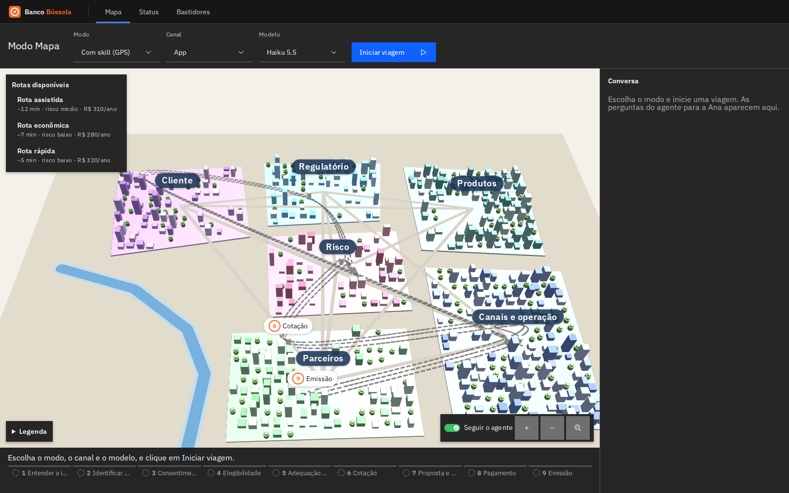

**Navegar:** arraste para mover, use a roda para o zoom e o botão direito para mudar a inclinação ou girar. "Enquadrar a cidade" volta à vista inicial, alinhada ao norte.

**Abrir um bairro:** clique no nome ou na placa do bairro, ou aproxime bem o zoom. Os sistemas daquele bairro aparecem como prédios com placas, e o status fica no telhado. Clique numa placa ou num prédio para ver os atributos, o estado vivo, a **proveniência** e os vizinhos. "Voltar à cidade" fecha o bairro.

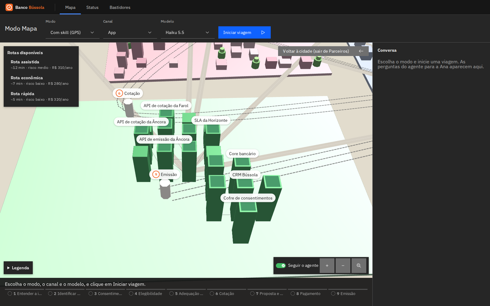

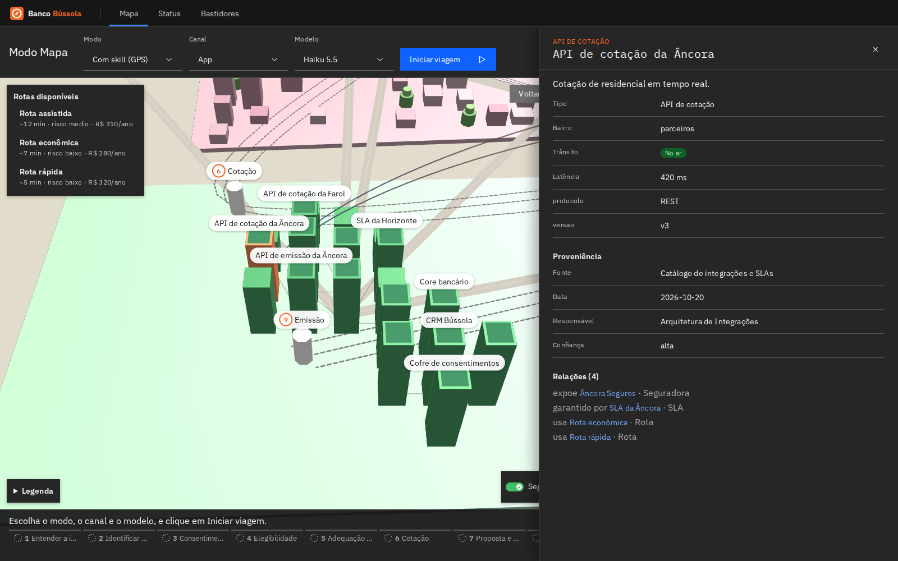

**Fazer uma viagem:**
1. Na barra de viagem, escolha o **modo** (com skill, sem skill ou sem contexto), o **canal** e o **modelo**. A opção "Roteiro (ensaio sem LLM)" não gasta tokens.
2. Clique em **Iniciar viagem**. O endereço muda para `/mapa?execucao=<id>`, e dá para abrir o mesmo link em outra tela.
3. O robô percorre a estrada parada a parada. Com "Seguir o agente" ligado, a câmera vai junto e abre o bairro de cada parada. A linha do tempo no rodapé e a narração mostram em que passo ele está.
4. Quando o agente perguntar algo à Ana, a pergunta aparece no painel **Conversa**. Responda com um dos botões ou escreva a resposta.
5. O selo no alto mostra "Reproduzindo" enquanto o mapa está atrás do agente e "Ao vivo" quando alcança. **Pular para o fim** alcança de uma vez.

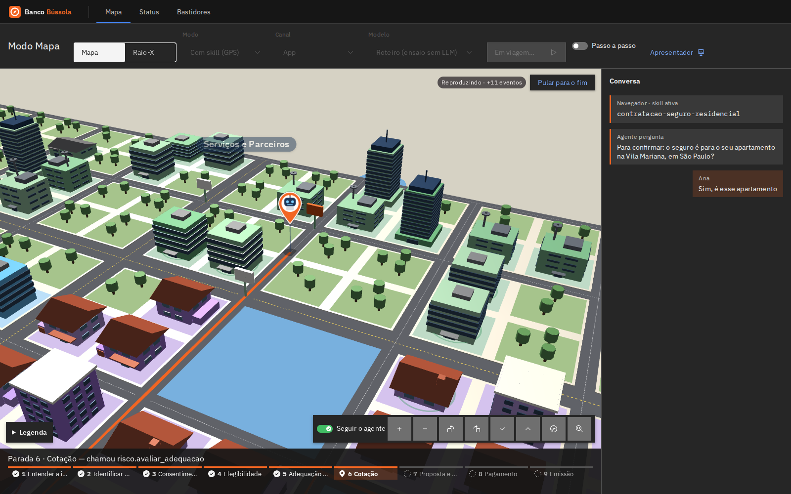

**Cenas prontas.** `/mapa?cena=6` deixa a barra pronta para a cena 6 e mostra o botão **Derrubar a API da Âncora**. Derrube a API: o farol vermelho sobe no bairro Parceiros e as rotas que passam por ali ficam interditadas. Depois, inicie a viagem e veja o desvio.

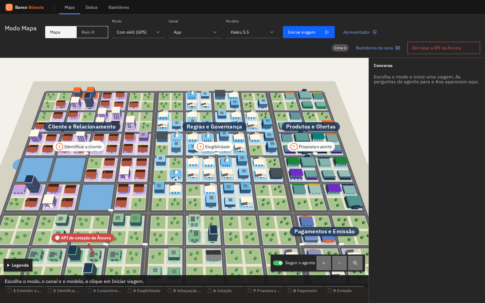

Depois, volte o mundo ao normal com `./scripts/incidente.sh reset`.

### O Modo Raio-X

O seletor **Mapa / Raio-X**, na barra do mapa, troca a apresentação sem reiniciar a viagem: é a mesma execução, vista por dentro. O endereço ganha `?visao=raio-x`.

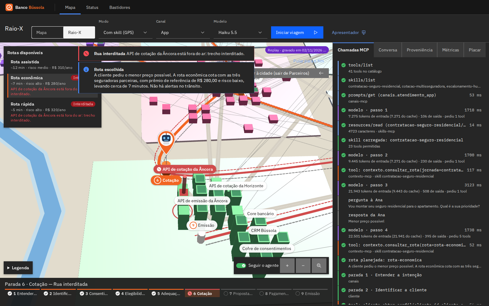

- **No mapa**, a cidade vira o grafo: todos os nós aparecem como prédios, com as relações entre eles. Passe o mouse numa relação para ver o tipo.
- **Chamadas MCP:** cada `tools/list`, `skills/list`, `resources/read`, `prompts/get`, chamada de tool, passo do modelo e decisão de rota, na ordem em que aconteceram, com duração e status. Bloqueios do gateway aparecem com cadeado. Clique numa linha para ver o evento cru do barramento.
- **Conversa:** a mesma do Modo Mapa. Quando o agente pergunta algo, as opções da Ana aparecem no topo do painel, em qualquer aba.
- **Proveniência:** as decisões do agente (rota, recálculo e incidente), com motivo e regra, e os sistemas e dados que ele tocou. Clique num deles para ver fonte, data, responsável e confiança.
- **Métricas:** tokens (com o que veio do cache), tempo no modelo e nas tools, custo, as regras do banco conferidas no fim e as tabelas por passo do modelo e por tool.
- **Placar:** a última viagem de cada modo nesta sessão, o agregado por modo × modelo e a referência do experimento Opus × Haiku.

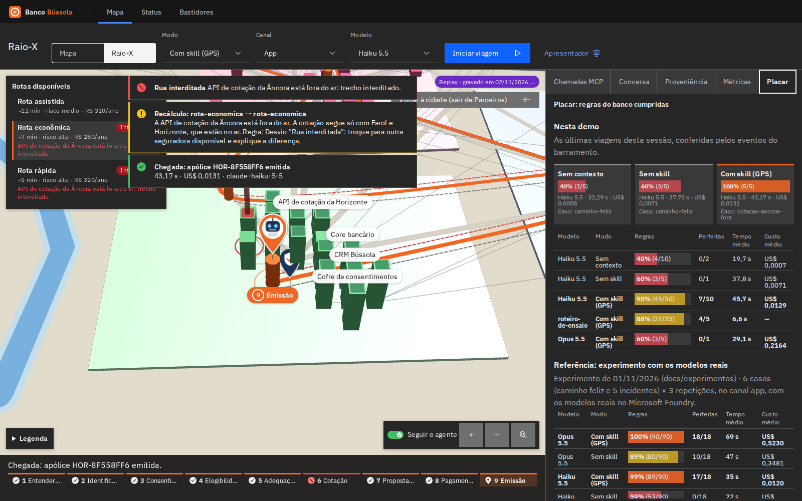

### O painel do apresentador

No mapa, a tecla **P** (ou o botão **Apresentador**) abre a gaveta do apresentador:

- **Cenas 1 a 8**, com o tempo-alvo e o filtro "versão curta" (1, 4, 5, 6 e 8). **Ao vivo** limpa o mundo e prepara o mapa para a cena; a viagem começa no **Iniciar viagem**. **Replay** toca a gravação da cena. A cena 8 abre o Raio-X na última viagem com skill.
- **Falas da Ana**, nas cenas 3 e 7: a do estorno e a da coleção de arte. Elas são enviadas como resposta quando o agente pergunta algo.
- **Pedágio:** as aprovações pendentes, com aprovar e recusar e a contagem até a especialista Marina aprovar sozinha (30 s).
- **Incidentes:** cada um com liga/desliga; o da cena atual aparece em destaque. Na cena 6, derrube a Âncora **durante** a viagem, para o recálculo acontecer ao vivo.
- **Tools desligadas** e **Mundo limpo**, que volta tudo ao estado-base.

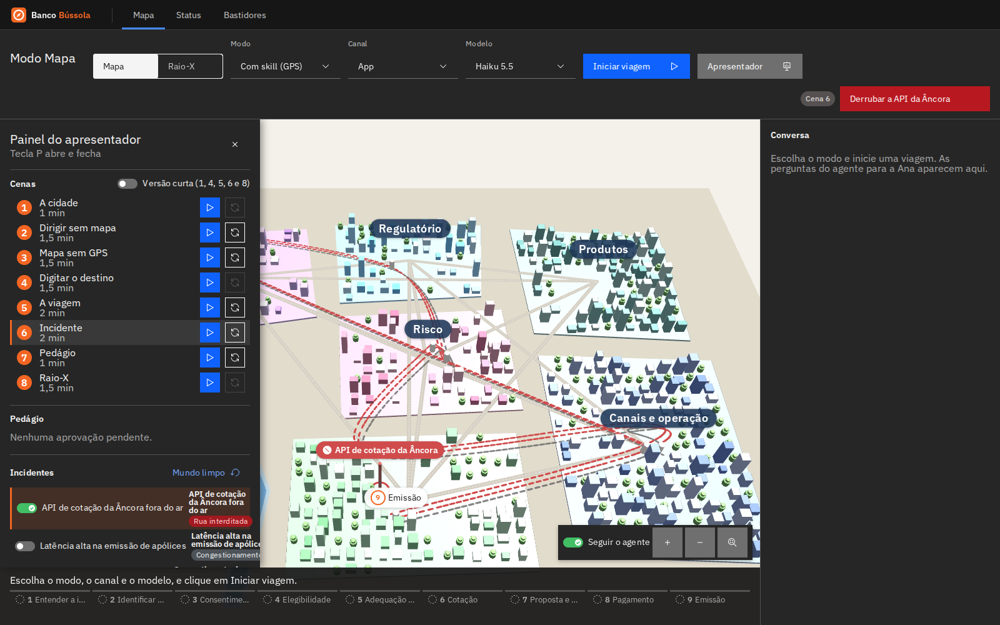

### Gravar e tocar (replay offline)

- No fim de uma viagem ao vivo, **Gravar esta viagem** salva a execução em `gravacoes/cena-<n>.jsonl` (ou com o id da execução, fora de uma cena). Grave de novo para substituir.
- `/mapa?gravacao=cena-6`, ou o botão **Replay** da gaveta, toca a gravação: sem rede, sem chave e sem LLM. O selo "Replay" fica visível o tempo todo.
- As gravações versionadas foram feitas com o Haiku de verdade. As cenas 4 e 8 usam a gravação da cena 5, que é a mesma viagem.
- Para regravar todas as cenas com o modelo do `.env` (gasta tokens, cerca de US$ 0,06 com o Haiku), use o roteiro de gravação descrito no capítulo 4.

### O dashboard de status

Em <http://localhost:8080/status> fica o console de quem monta e apresenta a demo:

- no topo, os indicadores: serviços no ar, tools (e quantas estão fora do ar), skills, prompts, o provedor de LLM e o barramento;
- abaixo, as abas **Serviços**, **Tools**, **Skills** e **Prompts**, cada uma com busca. Na aba Tools, há também um filtro por servidor.

Clique numa linha para abrir o **painel lateral**, que mostra o item por dentro:

| Item | O que o painel mostra |
| --- | --- |
| Tool | Descrição, servidor, as skills que a permitem, o **contrato** (parâmetros e JSON Schema), o **código Python real** com arquivo e linha, e as **últimas chamadas** no barramento |
| Skill | Frontmatter e governança, o `SKILL.md` renderizado, os arquivos de referência com digest verificado e o uso recente |
| Prompt | Canal, interlocutor e argumentos, a **prévia** renderizada para a Ana e o `.md` de origem |
| Servidor | Status, latência e tudo o que ele oferece, incluindo o que fica oculto |

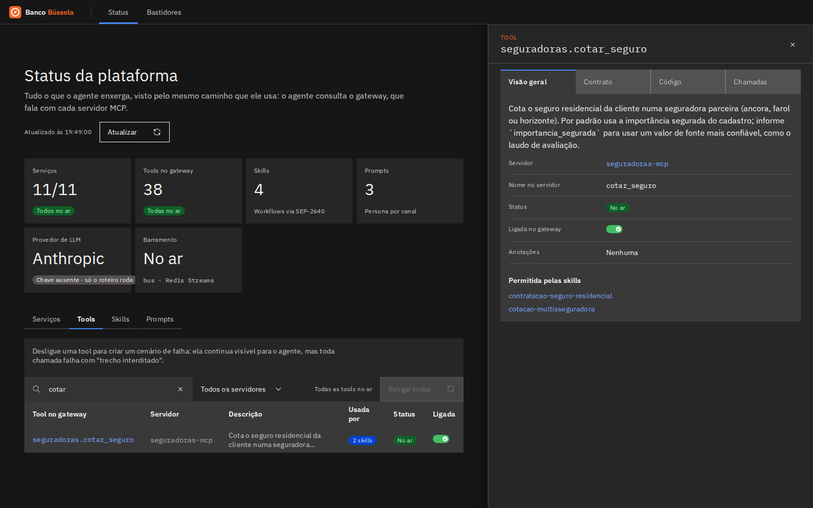

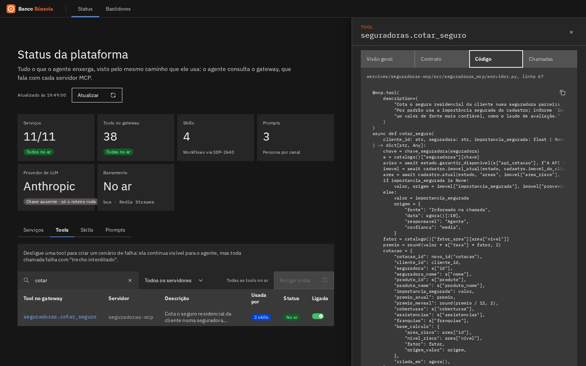

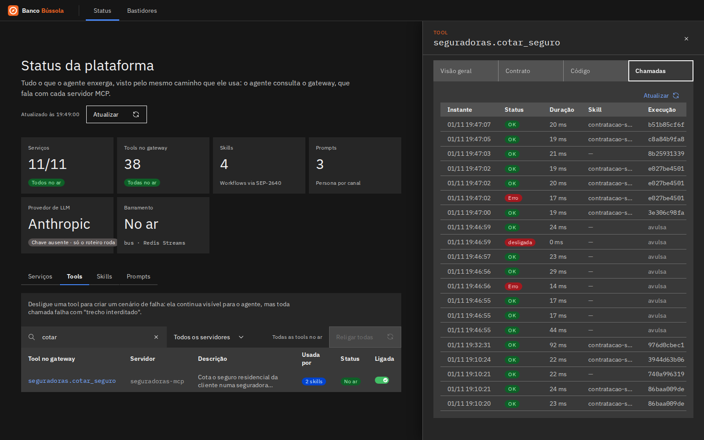

A URL acompanha a navegação. Por exemplo, `/status/tools/seguradoras.cotar_seguro` abre direto o painel dessa tool: dá para mandar o link para alguém.

### Desligar uma tool

Além dos incidentes, dá para criar falhas sob medida, tool a tool. Na aba **Tools** do dashboard, o toggle de cada linha (ou do painel da tool) desliga ou religa a tool, e **"Religar todas"** volta tudo ao normal. O indicador do topo mostra quantas estão fora.

Uma tool desligada **continua visível** para o agente, mas toda chamada falha com "trecho interditado". É a falha que o agente precisa perceber e contornar. O controle passa pelo simulador, pelo caminho `/simulador` do web; o agente não o alcança.

Pela linha de comando:

```bash
./scripts/incidente.sh desligar seguradoras.cotar_seguro
./scripts/incidente.sh tools                       # o que está fora do ar
./scripts/incidente.sh religar seguradoras.cotar_seguro
```

`incidente.sh reset` também religa todas as tools.

### Criar um novo incidente

Acrescente uma entrada em `services/simulator/incidentes.yaml`. Cada efeito aponta para uma entidade da ontologia, pelo id, e muda:

- `estado`: `status`, `latencia_ms`, `custo_estimado`, `vigencia_fim`;
- `atributos` ou `proveniencia`;
- relações (`relacoes_adicionar`).

Datas podem ser relativas (`$hoje`, `$ontem`). Depois de `docker compose up -d --build simulator`, o incidente aparece em `incidente.sh listar`. O smoke aplica todos os incidentes do catálogo ao mapa real, para garantir que nenhum aponta para entidade inexistente.

### Escrever uma nova skill

1. Crie `services/skills-mcp/skills/<nome>/SKILL.md`. O frontmatter precisa de `name` igual ao nome da pasta, de `description` (o que a skill faz e quando usar) e de `allowed-tools` com os nomes qualificados do gateway (`cliente.obter_perfil`...).
2. Se reutilizar outras skills, liste-as em `metadata.usa-skills` e aponte para elas pela URI (`skill://<nome>/SKILL.md`).
3. Coloque os trechos longos em `references/*.md` e cite cada um pela URI completa no `SKILL.md`.
4. `docker compose up -d --build skills-mcp`. Em até 30 s o gateway relê o catálogo, e `./scripts/gateway.sh --skills` mostra a skill nova.

Os testes recusam:

- skill com `name` diferente da pasta;
- tool fora do formato `prefixo.tool`;
- `usa-skills` que não existe;
- arquivo de apoio citado e ausente, ou presente e não citado.

O smoke confere que toda tool permitida existe no gateway.

Para testar a governança: `./scripts/gateway.sh <tool> '{...}' --skill <nome>`. Com skill, a ordem vale por execução: o script gera um id e mostra como repeti-lo com `--execucao <id>`, para encadear chamadas.

### Declarar a ordem de uma skill

Crie `workflow.yaml` na pasta da skill e cite-o no `SKILL.md` (`skill://<nome>/workflow.yaml`). Duas seções:

- `pre-requisitos`: para cada tool, a lista do que precisa ter dado certo antes, na mesma execução. Cada item é uma tool (`risco.consultar_elegibilidade`), uma tool com campos do resultado (`consentimento.verificar: { permitido: true }`) ou `qualquer:` com alternativas;
- `impedimentos`: tools que ficam bloqueadas depois que outra aconteceu.

Os testes do `skills-mcp` recusam um workflow mal formado ou que cite tools que a skill não permite.

### Dirigir o agente

`agente.sh` inicia uma execução e mostra a viagem no terminal, evento a evento. Sem chave de API, use o provedor `roteiro`:

```bash
./scripts/agente.sh executar --modo com_skill --provedor roteiro
```

Quando o agente pergunta algo à Ana, a execução pausa e o terminal mostra as opções sugeridas. Responda de outro terminal:

```bash
./scripts/agente.sh responder <id> --sugestao 1               # a primeira opção sugerida
./scripts/agente.sh responder <id> "Sim, é esse apartamento"  # texto livre
./scripts/agente.sh estado <id>                               # status, pergunta pendente e métricas
```

Para ensaiar sem apresentador, `--auto` responde sempre com a primeira opção. Os três modos:

```bash
./scripts/agente.sh executar --modo sem_contexto --provedor roteiro --auto   # zero tools, resposta inventada
./scripts/agente.sh executar --modo sem_skill    --provedor roteiro --auto   # tools irrelevantes
./scripts/agente.sh executar --modo com_skill    --provedor roteiro --auto   # as 9 paradas até a apólice
```

Com um incidente aplicado antes ou durante a viagem, o agente percebe e recalcula:

```bash
./scripts/incidente.sh aplicar cotacao-ancora-fora
./scripts/agente.sh executar --modo com_skill --provedor roteiro --auto
#   ⚠ incidente: Rua interditada · A API de cotação da Âncora Seguros está fora do ar...
# ◆ rota recalculada: rota-rapida → rota-economica · ...
```

O canal escolhe a persona: `--canal app` (padrão), `agencia` ou `central`. O modelo padrão é o Haiku 5.5. Para trocar o modelo de todas as próximas execuções, use o seletor no indicador de LLM do dashboard, ou `curl -X PUT localhost:8080/api/llm/modelo -H 'Content-Type: application/json' -d '{"modelo": "claude-opus-5-5"}'`. Para uma execução só, `--modelo claude-opus-5-5`. O fim da viagem mostra o custo em US$.

```bash
./scripts/agente.sh executar --modo com_skill --provedor roteiro --canal agencia --auto
# ◆ persona do canal: canais.atendimento_agencia (pelo gateway)
#   ? pergunta: Confirme com a Ana: o seguro é para o apartamento dela na Vila Mariana, em São Paulo?
```

Com o modelo configurado no `.env` (por padrão, o Claude no Microsoft Foundry: `ANTHROPIC_FOUNDRY_BASE_URL` e `ANTHROPIC_FOUNDRY_API_KEY`; veja o capítulo 6), rode sem `--provedor`: vale o `LLM_PROVIDER`. O indicador de LLM do dashboard mostra o modelo, a plataforma e se a chave está configurada. Depois de mudar o `.env`, recrie o agente com `docker compose up -d agent`.

Pela API, o mesmo caminho que o painel do apresentador vai usar:

```bash
curl -s -X POST localhost:8080/api/execucoes -H 'Content-Type: application/json' \
  -d '{"modo": "com_skill", "provedor": "roteiro"}'
curl -N localhost:8080/api/execucoes/<id>/eventos          # SSE
curl -s -X POST localhost:8080/api/execucoes/<id>/resposta -H 'Content-Type: application/json' \
  -d '{"texto": "Aceito"}'
```

### Medir com o modelo real

`experimento.sh` roda cada incidente nos modos `sem_skill` e `com_skill`, com o modelo do `.env`, e confere pelo barramento se o agente seguiu a regra do banco. **Gasta tokens de verdade.**

```bash
./scripts/experimento.sh rodar                       # 5 incidentes x 2 modos (~15 min)
./scripts/experimento.sh rodar vistoria-zona-sul     # só um incidente
./scripts/experimento.sh analisar 2026-11-01-claude-opus-5-5   # regras por caso, somando as repetições

# Comparar modelos: cada execução pode pedir um modelo de ANTHROPIC_MODELOS
./scripts/experimento.sh rodar --modelo claude-haiku-5-5 --repeticoes 3
./scripts/experimento.sh comparar 2026-11-01-claude-opus-5-5 2026-11-01-claude-haiku-5-5
```

O `comparar` mostra também o custo, pelos preços do `.env`. Mudar os preços ou os fatores de cache e comparar de novo não gasta tokens: o custo é recalculado a partir dos tokens gravados.

Os eventos completos ficam em `experimentos/<data>/`, fora do git. O relatório da primeira rodada está em `docs/experimentos/`.

### Escrever a persona de um canal novo

As personas são prompts MCP servidos pelo `canais-mcp`, um arquivo por canal:

```bash
./scripts/gateway.sh --prompts                                                   # as personas
./scripts/gateway.sh --prompt canais.atendimento_central '{"cliente_id": "cliente-ana"}'
```

1. Crie `services/canais-mcp/prompts/<canal>.md`. O frontmatter precisa de:
    - `name`, igual a `atendimento_<canal>`;
    - `canal`, o id de um `Canal` da ontologia (por exemplo, `canal-internet-banking`);
    - `title` e `description`;
    - `interlocutor`: com quem o agente fala nesse canal.
2. Escreva a persona em pt-BR: quem é o agente, com quem fala, o tom e o que pode prometer. Use `{cliente_nome}` e `{cliente_id}`, que o servidor preenche com o cadastro. Deixe de fora as regras de negócio: elas são da skill.
3. `docker compose up -d --build canais-mcp`. Em até 30 s o gateway relê o catálogo, e o canal passa a valer em `--canal <canal>`.

Os testes recusam um frontmatter incompleto ou um `name` fora do padrão. O smoke confere que o canal de cada persona existe na ontologia.

Para ver o fallback, pare o servidor: `docker compose stop canais-mcp`. A execução segue com a persona embutida, e o terminal mostra `◆ persona embutida` com o motivo. Depois, `docker compose start canais-mcp`.
